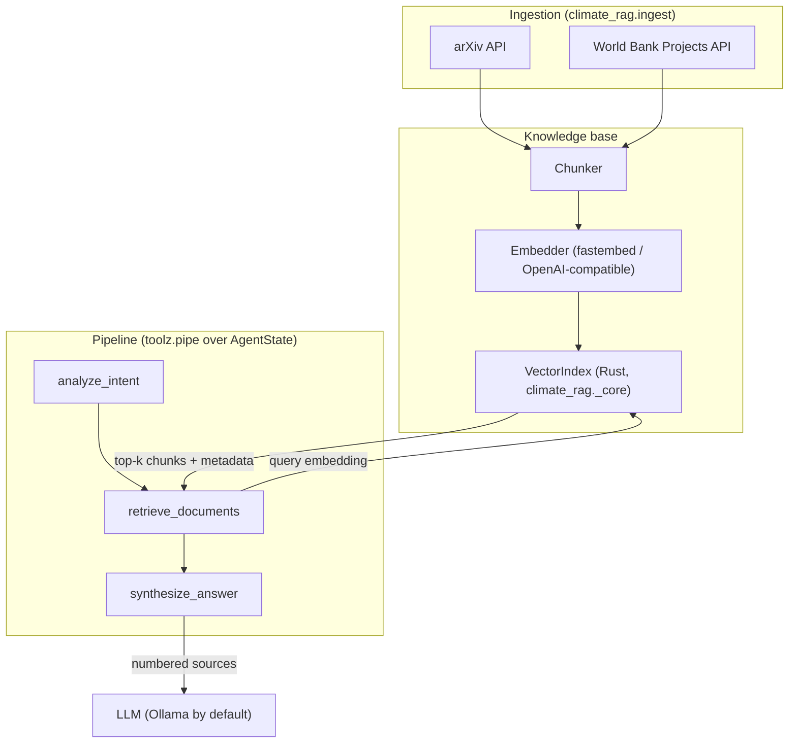

# 🌍 Climate Policy RAG

> **Retrieval-augmented question answering over climate research and World Bank projects**
> *Rust 🦀 vector index · Python 🐍 functional agent pipeline · local-first (no API keys needed)*

## 🚀 Overview

Climate information is scattered between academic research and the record of what is actually
being funded and built. This project pulls both into one searchable knowledge base and answers
questions with **cited, source-grounded** responses:

*   **Scientific evidence**: arXiv paper abstracts, searched by topic and ranked by relevance.
*   **Implementation evidence**: World Bank project abstracts (country, approval date, commitment).
*   **Rust core**: an in-memory cosine-similarity index exposed to Python through PyO3.
*   **Python agents**: intent analysis → retrieval → LLM synthesis, composed as pure functions
    over an immutable state object.

Everything runs locally by default: embeddings use a small ONNX model (`BAAI/bge-small-en-v1.5`
via fastembed) and answers come from a local [Ollama](https://ollama.com) model. Any
OpenAI-compatible endpoint can be swapped in through configuration.

## 🏗️ Architecture



### Design notes
*   **Immutable state**: `AgentState` is a frozen Pydantic model with tuple fields; each agent
    returns a new state, and the run log records every step.
*   **Injected dependencies**: retrieval takes a `KnowledgeBase`, synthesis takes an `LLM`
    callable `(system, user) -> str`, so the whole pipeline is testable offline with fakes.
*   **Retrieval modes**: plain vector search by default; optionally hybrid (BM25 keyword
    ranking in Rust, merged with the vector ranking by reciprocal rank fusion) and LLM query
    expansion. See `notes/retrieval_experiments.md` for why neither is the default yet.
*   **Grounded answers**: the model sees full chunk text as numbered sources, must cite them as
    `[n]`, and is told to say so when the sources don't answer the question.
*   **Resilient ingestion**: one shared HTTP client, all sources fetched concurrently, retries
    with exponential backoff on 429/5xx, arXiv's 3-second request spacing respected, and a
    failing source is logged and skipped rather than aborting the run.

## ⚡ Vector index performance

Vectors are unit-normalised when added and stored in one contiguous row-major buffer, so a query
is a single pass of dot products. The dot product uses 8 independent accumulators (which LLVM
auto-vectorises), large indexes are scored in parallel with Rayon, the top k come from an O(n)
partial selection rather than a full sort, and the GIL is released while scoring. Re-adding a
document id replaces it in place.

Embeddings arrive as float32 NumPy arrays and are read straight from the array buffer
(rust-numpy), so bulk inserts skip creating millions of Python floats:

| Bulk insert, 384-dim | Python lists | NumPy float32 |
|---|---|---|
| 10,000 rows | 0.32 s (~31k rows/s) | **0.03 s (~310k rows/s)** |
| 50,000 rows | 1.63 s | **0.16 s** |

Single-query search time is unchanged by the input type; scoring dominates.

Indexes persist as `embeddings.f32` (raw little-endian vectors), `documents.jsonl` and a
`manifest.json` recording the embedding model, so loading takes about a second instead of
re-fetching and re-embedding, and an index built with a different model is refused.

Search latency, 768-dim vectors, top 5 (Core Ultra 9 285H, 10 usable cores):

| Documents | Original implementation | Current | NumPy (pre-normalised matmul) |
|---|---|---|---|
| 10,000 | 2.82 ms | **0.47 ms** | ~2–4 ms |
| 50,000 | 10.04 ms | **3.45 ms** | ~5 ms |

At 50k documents the index is ~154 MB, so search is memory-bandwidth bound. Beyond a few hundred
thousand vectors an ANN index (HNSW) or a vector database such as Qdrant is the next step.

## 🛠️ Setup

### Prerequisites
*   Python 3.12+ and [`uv`](https://docs.astral.sh/uv/)
*   Rust toolchain (stable) for building the extension
*   [Ollama](https://ollama.com) with a chat model: `ollama pull gemma3:4b`

### Install

```bash
git clone https://github.com/captc/ClimatePolicyRAG.git
cd ClimatePolicyRAG
uv sync            # creates .venv, builds the Rust extension, installs everything
```

`uv sync` / `uv run` rebuild the extension automatically when files under `src/` change.
The embedding model (~65 MB) downloads to `~/.cache/fastembed` on first use.

## 🏃 Usage

```bash
# Answer a question over four built-in sample documents (no network ingestion)
uv run climate-rag demo "How potent is methane compared to CO2?"

# Fetch live arXiv + World Bank data once and save it (default topics, or your own)
uv run climate-rag ingest --out data/index
uv run climate-rag ingest --out data/ccs --topic "carbon capture storage" --limit 10

# Ask questions against a saved index (about a second to load)...
uv run climate-rag ask "What finance mechanisms exist for climate adaptation?" --index data/index
# ...optionally with keyword + vector retrieval and LLM query rephrasings
uv run climate-rag ask "How are NDCs tracked?" --index data/index --retrieval hybrid --expand
# ...or ingest live data for one question
uv run climate-rag ask "Barriers to carbon capture?" --topic "carbon capture storage"

# Answer and score the evaluation questions on the frozen corpus in eval/index
uv run climate-rag eval              # -> notes/Test_Queries.md + notes/Test_Queries.json
uv run climate-rag eval --judge      # also score claim-level faithfulness with an LLM judge
uv run climate-rag eval --retrieval-only --retrieval hybrid   # retrieval metrics in seconds
```

`python -m climate_rag ...` works too. Example output:

```text
Question: How potent is methane compared to CO2?
Intent:   scientific

Methane is significantly more potent than CO2 in terms of global warming potential. According
to the IPCC, methane has a global warming potential roughly 80 times that of CO2 over a
20-year period [1]. ...

Sources:
  [1] 0.733  IPCC                 Short-lived climate forcers
  [2] 0.509  UNFCCC               Paris Agreement, Article 2
```

### Configuration

All settings can be set as environment variables (or in a `.env` file):

| Variable | Default | Purpose |
|---|---|---|
| `CLIMATE_RAG_LLM_BASE_URL` | `http://localhost:11434/v1` | Any OpenAI-compatible chat endpoint |
| `CLIMATE_RAG_LLM_MODEL` | `gemma3:4b` | Chat model name |
| `CLIMATE_RAG_LLM_API_KEY` | `ollama` | API key (ignored by Ollama) |
| `CLIMATE_RAG_LLM_MAX_TOKENS` | `512` | Cap on answer length |
| `CLIMATE_RAG_EMBEDDING_BACKEND` | `fastembed` | `fastembed` (local ONNX) or `openai` (uses the LLM endpoint) |
| `CLIMATE_RAG_EMBEDDING_MODEL` | `BAAI/bge-small-en-v1.5` | Embedding model |
| `CLIMATE_RAG_JUDGE_MODEL` | (`LLM_MODEL`) | Judge for `eval --judge`; use a stronger model than the generator |
| `CLIMATE_RAG_JUDGE_BASE_URL` / `_API_KEY` | (`LLM_*`) | Endpoint and key for the judge |
| `CLIMATE_RAG_RETRIEVAL_MODE` | `vector` | `vector`, or `hybrid` (vector + BM25 keywords, rank-fused) |
| `CLIMATE_RAG_QUERY_EXPANSION` | `false` | Also search with LLM-written rephrasings of each question |
| `CLIMATE_RAG_TOP_K` | `5` | Chunks retrieved per question |
| `CLIMATE_RAG_CHUNK_CHARS` | `2000` | Maximum chunk size |

To use OpenAI instead of Ollama, for example:
`CLIMATE_RAG_LLM_BASE_URL=https://api.openai.com/v1 CLIMATE_RAG_LLM_API_KEY=sk-... CLIMATE_RAG_LLM_MODEL=gpt-4o-mini`.

### Troubleshooting

*   **Ollama is extremely slow** on machines where it is confined to fewer CPUs than the system
    has (cgroup/cpuset limits, `intel_lpmd`): llama.cpp starts one thread per core and the extra
    threads stall each other. Create a variant with a lower thread count and use it:
    ```bash
    printf 'FROM gemma3:4b\nPARAMETER num_thread 8\n' > Modelfile
    ollama create gemma3-4b-8t -f Modelfile
    export CLIMATE_RAG_LLM_MODEL=gemma3-4b-8t
    ```

## 📏 Evaluation

`climate-rag eval` answers the questions in `eval/gold.json` against the frozen corpus in
`eval/index` (80 documents from 2026-10-19, committed so runs are comparable) and scores each
answer in three layers:

1.  **Retrieval**: document-level recall@k and reciprocal rank against hand-labelled relevant
    documents. Labels are tied to the corpus by its `corpus_id` and skipped for any other corpus.
2.  **Deterministic checks**: citations must point at real sources, and every number in the
    answer must appear in a source it cites. No model involved, so these are reproducible.
3.  **LLM judge** (`--judge`): the answer is split into claims, each marked supported,
    unsupported or contradicted by the sources; faithfulness is the supported share. Configure
    a stronger judge than the generator with `CLIMATE_RAG_JUDGE_*`.

The Markdown report lists flagged claims and numbers per question; the JSON file next to it
holds every score for comparing runs. To rebuild the corpus, run
`climate-rag ingest --out eval/index` and relabel `eval/gold.json`, since its labels refer to
document ids in the old corpus.

## 🧪 Development

```bash
uv run pytest                 # offline test suite (fixtures + fake embedder/LLM)
uv run pytest -m network      # live smoke test against arXiv and the World Bank
uv run ruff check . && uv run mypy

# Rust unit tests link libpython, so point them at the venv's interpreter and its library
export PYO3_PYTHON=$PWD/.venv/bin/python
export LD_LIBRARY_PATH=$($PYO3_PYTHON -c "import sysconfig; print(sysconfig.get_config_var('LIBDIR'))")
cargo test --release
```

## 📂 Project structure

```
ClimatePolicyRAG/
├── Cargo.toml / pyproject.toml   # maturin mixed Rust/Python project
├── src/                          # 🦀 Rust extension (climate_rag._core)
│   ├── lib.rs                    # PyO3 module definition
│   ├── keyword.rs                # BM25 keyword ranking + unit tests
│   ├── models.rs                 # Document, SearchResult
│   └── vector_store.rs           # VectorIndex + unit tests
├── climate_rag/                  # 🐍 Python package
│   ├── _core.pyi                 # type stubs for the Rust module
│   ├── agents/                   # analysis, query expansion, retrieval, synthesis
│   ├── ingest/                   # arXiv + World Bank adapters, concurrent ingestion
│   ├── cli.py                    # demo / ask / eval commands
│   ├── config.py                 # pydantic-settings configuration
│   ├── embeddings.py             # Embedder protocol + backends
│   ├── evaluation.py             # retrieval metrics, answer checks, LLM judge
│   ├── knowledge_base.py         # chunking, index wrapper, save/load
│   ├── llm.py                    # OpenAI-compatible chat client
│   ├── models.py                 # immutable pipeline state
│   └── pipeline.py               # functional orchestration
├── eval/                         # frozen eval corpus (index/) + questions and labels (gold.json)
├── tests/                        # pytest suite and API fixtures
└── notes/                        # data-source survey and the latest eval report
```

## ⚠️ Limitations

*   Saved indexes are rebuilt, not updated: re-running `ingest` replaces the corpus.
*   Intent classification is keyword based; it only steers the answer's emphasis.
*   The eval set is small (10 questions, 46 relevance labels made by one annotator), so treat
    scores as regression signals rather than benchmarks.
*   Retrieval misses vocabulary gaps: documents about "MRV" and national inventories are not
    matched to a question about "NDC tracking". Query expansion recovers some of them but
    costs recall elsewhere; on this small eval set no retrieval mode is reliably better than
    plain vector search (`notes/retrieval_experiments.md`).
*   A model judging its own answers is not a usable judge: with `gemma3:4b` as both
    generator and judge, faithfulness came out 1.00 on every question, including an answer
    claiming CO2 has a GWP of 42 (it is 1 by definition). The number check cannot catch that
    either, because both figures appear in the source. Use a stronger judge model.
*   The World Bank search matches loosely, so some ingested projects are off topic; retrieval
    usually ranks them low.

## 🔮 Roadmap

-   [ ] More sources from `notes/data_sources.md` (Climate Watch, OWID CO2, climate-laws.org).
-   [ ] A larger eval set with a dev/test split, then tune rank fusion (pool size, weighting
        the original query) for hybrid retrieval and query expansion.
-   [ ] Incremental ingestion into an existing index; Qdrant backend for large corpora.
-   [ ] Docker image and a small web UI.
